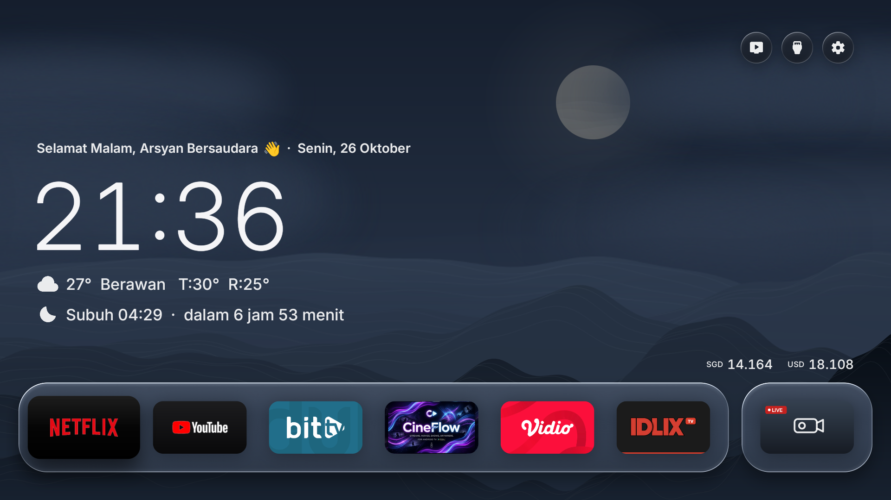
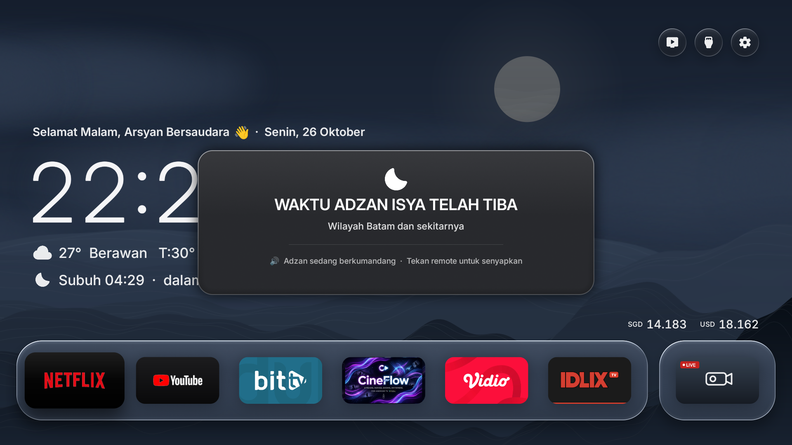
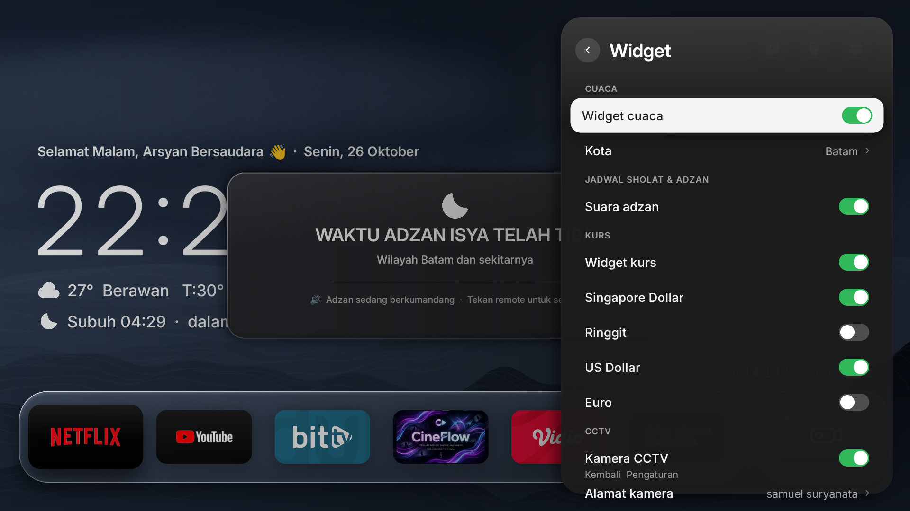

# Arsyan TV Launcher v2.0

A clean, modern, and aesthetic Android TV launcher inspired by Nothing OS and Apple TV design philosophies. Built natively for Android TV and Google TV devices with fluid glassmorphism, clean typography, live dynamic weather, real-time Air Quality Index (AQI), currency exchange rates, daily Islamic prayers/ayahs, **Now Playing music overlay (BitChord / Spotify / YouTube Music)**, and automatic Adzan prayer time notifications specifically tailored for Kota Batam.

---

## 📺 Showcase

### 1. Minimalist Home Screen with Now Playing Widget
Clean typography layout for the clock, real-time weather, AQI index, prayer countdown, and daily prayers (Doa Harian). When music is playing from **BitChord** or other media players, a sleek frosted-glass **Now Playing card** appears seamlessly above the currency line with album art, track details, progress bar, and play/pause status.



---

### 2. Centered Adzan Notification (~50% Screen)
An elegant, frosted smoked-glass modal (50% width) displayed in the center of the screen when prayer time arrives, accompanied by full Adzan audio that can be silenced immediately with any remote button.



---

### 3. Widget & Sound Settings
Easily toggle Adzan sound on or off directly through the TV settings or within the drawer widget area.



---

## ✨ Features

- **Exclusive Focus on Android TV**:
  - Engineered natively for Android TV & Google TV (API 28+ / Android 9 to Android 14+).
  - Lightweight custom drawing pipeline using native Android `Canvas` without heavy WebView or hybrid framework overhead (runs at smooth 60 fps).
- **Now Playing Music Widget (BitChord & Universal Media)**:
  - Automatically captures active playback metadata from **BitChord** (`com.music.bitchord.tv`), Spotify, YouTube Music, and any Android media app via native `MediaSession`.
  - Displays high-resolution rounded album cover art, song title, artist, progress line, and live play/pause indicator.
  - Positioned symmetrically on the right side above currency rates.
  - **Smart Visibility**: Automatically appears when music is playing or paused, and cleanly auto-hides when music stops to keep the home screen minimalist.
- **Over-The-Air (OTA) Updates via GitHub Releases**:
  - Direct in-app update mechanism powered by GitHub Releases API (`ssemyy-sds/arsyan-tv-launcher`).
  - Automatic background update checks with ambient notification banners when new versions are available.
  - Manual check & install directly from **Settings → About (Pembaruan Sistem / OTA)**.
  - Features real-time download progress and seamless installation without requiring a computer or ADB connection for future updates.
- **Dynamic Daily Prayer & Ayah (Doa Harian) from GitHub Raw**:
  - Expanded to **71 authentic daily prayers and Quranic ayahs** sourced dynamically from GitHub Raw CDN (`iherbs/quran-json`).
  - **Offline-First Architecture**: Caches prayers locally to ensure the home screen always loads instantly (0ms latency) even without an active internet connection.
  - **Accurate Local Time Rotation**: Automatically switches to the next prayer at 00:00 midnight local TV time (`Calendar.DAY_OF_YEAR`), eliminating UTC timezone offset delays.
- **Air Quality Index (AQI) for Kota Batam**:
  - Live Air Quality data integration via Open-Meteo Air Quality API.
  - Displays US AQI values and qualitative categories (`Baik`, `Sedang`, `Sensitif`, `Tidak Sehat`, dll.) directly alongside the weather line.
- **Prayer Times & Adzan for Kota Batam**:
  - Automatically calculates the five daily prayer times (Subuh, Dzuhur, Ashar, Maghrib, Isya) for Kota Batam (`1.1301° N, 104.0529° E`).
  - Next prayer countdown displayed directly on the home screen.
  - Background alarm scheduling (`AlarmManager.RTC_WAKEUP`) ensures timely alerts even if the launcher is in the background or sleeping.
  - **Smart Audio Focus Management**: Automatically pauses background media apps (YouTube, Spotify, video players) during the Adzan call, and seamlessly resumes playback once dismissed.
  - **Floating Banner Overlay**: Powered by a dedicated foreground service (`AdzanService`) to display a sleek frosted-glass alert banner on top of other running apps (like YouTube) without stealing remote control focus.
  - Full Adzan audio playback with one-click silence using any remote control key.
- **Weather & Exchange Rates**:
  - Open-Meteo integration for accurate temperature, conditions, and daily high/low.
  - Real-time SGD and USD currency exchange rates.
- **Clean Typography UI**:
  - Restores the minimalist typographic aesthetic without frosted card boxes obscuring the wallpaper.
- **Smooth Animations & Hardware Efficiency**:
  - Highly optimized for low-end to high-end Android TV boxes and Smart TVs (ZTE, Mi Box, TCL, Sony, etc.).

---

## 🛠️ Building & Installing

### Prerequisites
- JDK 17+ or JDK 21+ (compatible with modern JDKs, including JDK 26)
- Android SDK (`build-tools 35.0.0` or `34.0.0`, `platforms/android-34`)
- ADB tools for TV connection

### Build APK
Run the build script:
```bash
bash ./build.sh
```
This compiles the project and produces **`ArsyanTV.apk`** in the root directory.

### Install to Android TV
1. Enable **Developer Options** and **Network Debugging / USB Debugging** on your Android TV.
2. Connect to your TV over ADB:
   ```bash
   adb connect <TV_IP_ADDRESS>:5555
   ```
3. Install the APK:
   ```bash
   adb -s <TV_IP_ADDRESS>:5555 install -r ArsyanTV.apk
   ```
4. Grant the display overlay permission (for the on-screen Adzan banner over other apps):
   ```bash
   adb -s <TV_IP_ADDRESS>:5555 shell appops set io.freemytv SYSTEM_ALERT_WINDOW allow
   ```
5. Grant notification listener permission (for the Now Playing music card):
   ```bash
   adb -s <TV_IP_ADDRESS>:5555 shell cmd notification allow_listener io.freemytv/.NowPlayingService
   ```

> [!TIP]
> **Subsequent Updates (OTA):** Once Arsyan TV is installed, you no longer need to use ADB or a laptop for future updates! Simply publish a new release on GitHub, and your TV will detect and install the update wirelessly via **Settings → About → Pembaruan Sistem (OTA)**.

---

## 🙏 Credits & Acknowledgments

This project is built upon the wonderful work of the open-source community:

- **[Free My TV](https://github.com/simbasjungles/free-my-tv)** by [simbasjungles](https://github.com/simbasjungles) – The foundational open-source Android TV launcher codebase and design architecture.
- **[WeatherGlass TV](https://github.com/faizaldjoo/weatherglass-tv)** by [faizaldjoo](https://github.com/faizaldjoo) – Islamic prayer calculations and weather glass UI inspiration.
- **[BitChord](https://github.com/kushagrasinghx/BitChord)** by [kushagrasinghx](https://github.com/kushagrasinghx) – Open-source music client for Android TV.
- **[quran-json](https://github.com/iherbs/quran-json)** by [iherbs](https://github.com/iherbs) – Curated Indonesian daily prayer dataset.
- Modified and maintained by **semy** (Arsyan TV).

---

## 📄 License

This repository is distributed under the MIT License. See [LICENSE](LICENSE) for details.
